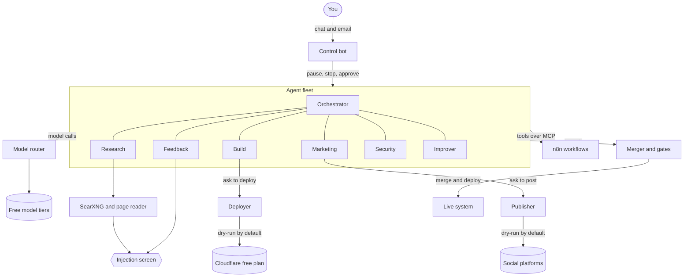

# free-agent-fleet

A small online business that runs itself on one Linux machine, for $0.

A team of seven AI agents finds a real customer pain, builds a product, markets it, talks to customers, and learns from feedback. You stay in charge. The fleet asks before it ships, posts, or installs anything. A kill switch stops it at once.

The fleet is built on [Hermes Agent](https://github.com/NousResearch/hermes-agent). It uses free model tiers, a self-hosted search engine, and the free plan of Cloudflare. It needs no credit card.

> Status: early. It runs end to end with a mock model and in dry-run mode. Real models, real posts, and real deploys need keys that you add yourself. Read [SECURITY.md](SECURITY.md) first.

## What it does

- **Finds a pain.** The research agent reads Hacker News, Stack Exchange, GitHub issues, and public pages. It scores each idea on pain, proof of payment, reachable buyers, build effort, competitors, and legal risk.
- **Builds the product.** The build agent writes a small app for Cloudflare Workers and Pages. It writes tests first. It deploys only through a plain-code Deployer that checks the free-plan rules.
- **Markets it.** The marketing agent writes the copy and the posts. A plain-code Publisher holds the social tokens, checks honesty rules, and sends the post. Agents never hold a token.
- **Talks to customers.** The feedback agent reads quarantined messages and answers only from an approved FAQ. It turns what it learns into tickets.
- **Improves itself.** The improver agent reviews traces each week and opens changes. A merger runs every gate before a change goes live.
- **Reports to you.** A daily brief of 150 words or fewer arrives by chat and email. It lists what was achieved, what is next, the limits, and what you can do.

## What it costs

$0. The fleet refuses any paid model in code (`ops/router/freeonly.py`) and a policy test checks it. You add no payment method anywhere.

Free tiers change, and some come with strings:

- Some free tiers may use your prompts to improve their products.
- Some free tiers forbid commercial use. NVIDIA and Cohere are marked development only.
- Free limits are small. The fleet slows down at 80 percent of a daily limit.

Read the terms of each provider before you run a business on it. Links are in `config/router/combos.yaml`. The command `fleetctl router approve PROVIDER` makes you confirm that you read them. The fleet rules forbid sending customer data to a provider that may train on prompts.

## What you need

- A Debian 13 or Ubuntu 24.04 machine on x86-64 or arm64. It stays on 24 hours a day with a wired network.
- 8 GB of RAM is comfortable. 4 GB works without a local model. 20 GB of free disk.
- A free API key from one model provider. See [docs/PROVIDERS.md](docs/PROVIDERS.md).
- One chat app for the control bot: Slack, Telegram, or Discord.
- About 15 minutes.

## Quick start

```
git clone <the address of this repository>
cd free-agent-fleet
./install.sh
fleetctl setup
```

`./install.sh` is safe to run twice. It pins every version, uses only official sources, and never asks for a key. `fleetctl setup` is a guided wizard. It takes one free provider key, one chat app, and the n8n owner account. Keys go in with hidden input and are never printed.

Then check the machine:

```
fleetctl doctor
fleetctl test
```

Every part reports OK or WAITING_FOR_KEYS. The fleet stays idle until a model key exists.

If you use an AI coding agent, give it [docs/PROMPT_FOR_YOUR_AGENT.md](docs/PROMPT_FOR_YOUR_AGENT.md). It does the setup with you and stops only for steps that need your hands.

## How it fits together



The agents run as Hermes profiles in a Docker sandbox. Plain-code services hold every secret and every outside action. The agents hold none.

## The safety model

- **Dry-run by default.** The Publisher and the Deployer write what they would do. Nothing leaves the machine until you turn dry-run off and approve a release.
- **Injection screen.** All outside text goes through a local classifier before an agent reads it. A blocked item never reaches an agent.
- **Rule of Two.** No agent may read untrusted text, hold sensitive access, and take outside actions at the same time. A test enforces it.
- **Owner approvals.** You approve each product spec, each release, each install, and each sync of this public repository.
- **Install gate.** Every new skill or tool goes through owner and name checks, license checks, scanners, and a sandbox trial before it is pinned to a commit.
- **Tool catalog.** `config/catalog.yaml` rates each outside tool as adopt, trial, watch, or reject. Agents never request a rejected tool, and a rating is never an approval.
- **Locked core.** The rules, the policy tests, the kill switch, and the Hermes managed config are owned by root. The fleet cannot change them.
- **Merger.** Every change from an agent passes tests, scanners, and policy gates in a throwaway container with no network. A failed health check rolls the change back.
- **Kill switch.** `fleetctl pause`, `fleetctl stop`, and `fleetctl revoke-checklist`. The control bot lives outside the fleet, so `/stop` cannot stop it.

## Commands

| Command | What it does |
|---|---|
| `fleetctl status` | What runs, the pause state, keys, budget, and the active project |
| `fleetctl doctor` | Checks every part. Exit 0 when all are OK or waiting for keys |
| `fleetctl test` | Runs the policy, unit, and injection tests |
| `fleetctl pause` and `fleetctl resume` | Stop new work, and start it again |
| `fleetctl stop` and `fleetctl start` | Stop and start every service |
| `fleetctl secret set NAME` | Save one key with hidden input |
| `fleetctl brief --now` | Make the daily brief now |
| `fleetctl n8n selftest` | Test the workflow links, with owner messages held back |
| `fleetctl update` | Bring new code in through the merger gates |
| `fleetctl catalog list` | The rated list of outside tools and skill sources, with the reason for each rating |

## Documents

- [docs/ARCHITECTURE.md](docs/ARCHITECTURE.md): the parts and how they talk
- [docs/RUNBOOK.md](docs/RUNBOOK.md): pause, stop, revoke, roll back, pivot, update, uninstall
- [docs/SECURITY.md](docs/SECURITY.md): which service reads which secret
- [SECURITY.md](SECURITY.md): how to report a vulnerability
- [docs/PROVIDERS.md](docs/PROVIDERS.md): free model providers and their limits
- [docs/SLACK.md](docs/SLACK.md): Slack setup
- [docs/N8N.md](docs/N8N.md): the workflow engine
- [CONTRIBUTING.md](CONTRIBUTING.md) and [THIRD_PARTY.md](THIRD_PARTY.md)

## License

MIT. See [LICENSE](LICENSE). The parts that this project installs have their own licenses. See [THIRD_PARTY.md](THIRD_PARTY.md).
